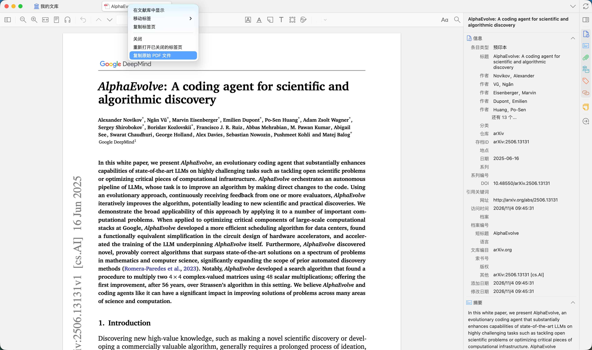
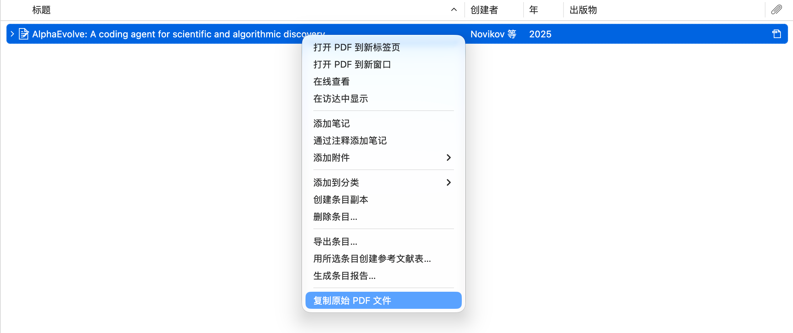

# Quick Copy PDF

English | [简体中文](README-zh.md)

Copy original PDF files from Zotero library items and PDF reader tabs to the system clipboard. Select several items to copy their PDFs together. When an item has multiple PDFs, choose the attachment to copy.

**Copy from a PDF reader tab:**



**Copy from a library item:**



## Why I built this

I often need to send a paper's PDF to an AI app to help me read, understand, or discuss it. The usual workflow takes too many steps: find the paper in Zotero, locate its PDF on disk, then copy or drag the file into the AI app. I built this small plugin to put a **Copy Original PDF File** command directly in the context menus for library items and PDF tabs, making it easier to share papers with AI.

After copying, paste the file into any AI app that supports pasting files. Whether this works depends on the receiving app.

## Installation

Supports **Zotero 8–10 (8.0–10.0.x)** on macOS and Windows. Zotero 7 and earlier are not supported.

1. Download `quick-copy-pdf-1.2.0.xpi` from [Releases](https://github.com/Huaisure/zotero-quick-copy-pdf/releases/latest). The automatically generated Source code archives are not installable plugins.
2. In Zotero, open **Tools → Plugins**.
3. Click the gear icon, choose **Install Plugin From File…**, and select the downloaded `.xpi` file.

## Usage

The plugin's menu command and dialogs are currently in Chinese. **复制原始 PDF 文件** means **Copy Original PDF File**.

- **Library item:** Right-click a paper and select **复制原始 PDF 文件**. A single PDF is copied immediately; if there are multiple PDFs, a dialog lets you choose one.
- **Multiple items:** Select several papers, right-click, and choose **批量复制原始 PDF 文件** (Copy Original PDF Files). The plugin copies one PDF per item in a single operation. Items without PDFs are skipped; for each item with multiple PDFs, choose one in a dialog showing the paper title. Duplicate files are included only once.
- **PDF attachment:** You can also right-click a PDF attachment under a paper to copy that file directly.
- **Reader tab:** Open a PDF, right-click its tab at the top, and select **复制原始 PDF 文件**. The plugin copies the PDF belonging to that tab, even if the tab is not currently active.
- **Paste:** On macOS, press `⌘V` in a Finder folder or an app that supports pasting files. On Windows, press `Ctrl+V` in a File Explorer folder or a compatible app.

The command is hidden when none of the selected items has a PDF. Canceling any attachment dialog or encountering a missing or unreadable file cancels the entire operation before writing to the clipboard, leaving its previous contents unchanged.

## What “original file” means

The plugin places the local attachment file on the system clipboard, preserving its filename and exact bytes. It does not export or rewrite the PDF. Annotations stored only in Zotero's database are not embedded; content already present in the PDF is preserved.

Both Zotero-managed attachments and linked local files are supported. If a PDF has not been downloaded or its file is missing, the plugin asks you to download or locate it first. It does not download attachments automatically. Web links alone are not treated as local PDFs.

The plugin does not modify item metadata or upload papers or PDFs. Zotero can check for plugin updates through this repository's `updates.json`.

## Development and building

Using the plugin requires no Node.js, Python, or additional dependencies. Development tests require Node.js 18+, and packaging uses the Python 3 standard library.

```sh
node --test test.cjs
python3 build.py
```

The build produces `dist/quick-copy-pdf-1.2.0.xpi` and updates `updates.json` in the repository root, including the package's SHA-256 hash. The package contains only `manifest.json` and `bootstrap.js`.

The plugin uses Zotero's official `MenuManager` API with the `main/library/item` and `main/tab` targets. Single-file copying uses Mozilla's `application/x-moz-file` clipboard format. For multiple files, the plugin uses JS-ctypes to write an `NSURL` list to macOS `NSPasteboard` or a Unicode `CF_HDROP` list on Windows. Paths are passed directly to native APIs, preserving Chinese characters and other Unicode filenames. No PowerShell or external program is required to run the plugin.

To publish a new version, update the version in `manifest.json`, run the tests and build, commit the generated `updates.json`, and upload the XPI from that same build to the corresponding `v<version>` GitHub Release. The download URL and file hash in the update manifest must match the release asset.

For native runtime tests, build first, then run `python3 tests/runtime.py /path/to/zotero` (on Windows, use `python` and the path to `zotero.exe`). The script creates a temporary profile and library, uses only the generated test PDF in this repository, and overwrites the system clipboard. It closes the test instance when finished and keeps the temporary directory for troubleshooting.

## Validation coverage

- 20 automated tests cover menu registration and cleanup, copying a single file, choosing between multiple PDFs, cancellation, empty selections, non-PDF items, missing or unreadable files, background tab targeting, asynchronous operations during shutdown, unchanged Windows drive and UNC paths, the installation manifest, batch collection and deduplication, mixed selections, and cancellation or failure midway through a batch.
- On both macOS and Windows x64, Zotero **8.0, 9.0, and 10.0.7** each passed 16 runtime checks covering actual plugin loading, both context menus, the native file clipboard, the attachment chooser and cancellation, inactive PDF tab targeting, disabling and re-enabling the plugin, the actual multi-selection menu, and switching between single-file and batch copying.
- On both platforms, a separate process reads the complete native file list after batch copying and cancellation, verifies two distinct paths (including Chinese characters, punctuation, and emoji), copies both files, and checks their SHA-256 hashes.
- Tests used generated PDFs, not a personal library.

Windows checks ran on GitHub-hosted Windows x64 runners; see the [passing test run](https://github.com/Huaisure/zotero-quick-copy-pdf/actions/runs/41989003484). Pasting into Windows 10/11 File Explorer, network shares, and individual AI, chat, or email apps has not been manually tested across all combinations. Linux has not been tested. The plugin copies files, so the receiving app must support file clipboard data.

## References

- [Zotero plugin development](https://www.zotero.org/support/dev/client_coding/plugin_development)
- [Official MenuManager documentation](https://www.zotero.org/support/dev/zotero_8_for_developers#custom_menu_items)
- [Zotero 10 developer notes](https://www.zotero.org/support/dev/zotero_10_for_developers)
